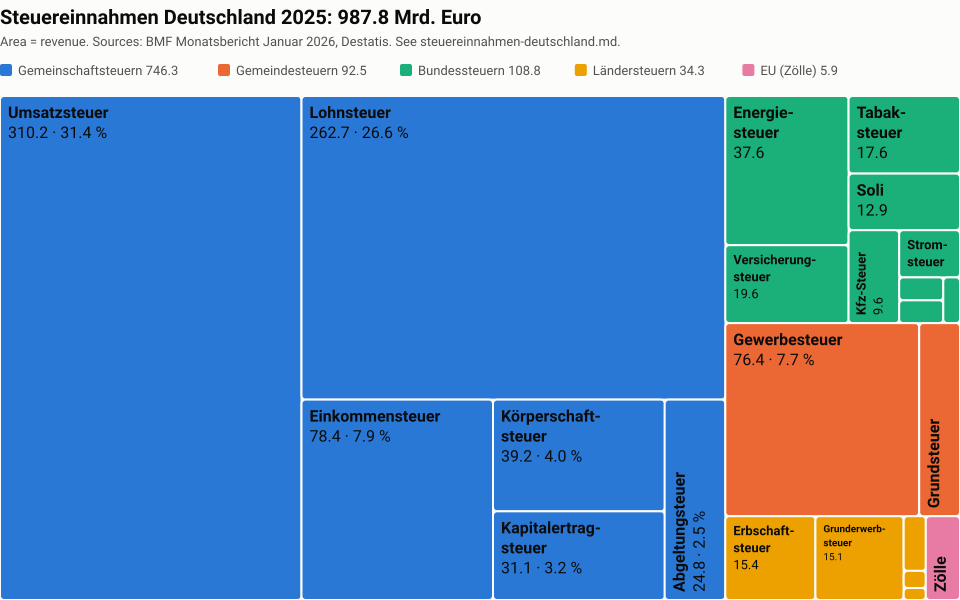

# Tax Revenue in Germany by Tax Type

Status: research notes, collected 2026-10-27.

This file lists the main taxes in Germany, ordered by the revenue that they raise. The figures are cash
receipts (kassenmäßige Steuereinnahmen) of all levels of government: Bund, Länder, Gemeinden and the EU
share. Amounts are in billion euro (Mrd. Euro), rounded to one decimal.

## Ranking 2025

The area of each tile is proportional to the revenue, and the color shows the level of government. Hover a
tile to see its exact value. To regenerate the chart after a data change, edit the data in `treemap.py` and
run `python3 research/treemap.py > research/steuereinnahmen-2025-treemap.svg`.

| #  | Tax                                                           |  2025 |  2024 | Level        |
| -- | ------------------------------------------------------------- | ----: | ----: | ------------ |
| 1  | Steuern vom Umsatz (VAT, incl. Einfuhrumsatzsteuer)           | 310.2 | 302.1 | Gemeinschaft |
| 2  | Lohnsteuer (wage tax, net of Kindergeld, see note 1)          | 262.7 | 248.9 | Gemeinschaft |
| 3  | Veranlagte Einkommensteuer (assessed income tax)              |  78.4 |  74.8 | Gemeinschaft |
| 4  | Gewerbesteuer (trade tax, gross, see note 2)                  | ~76.4 | ~75.3 | Gemeinde     |
| 5  | Körperschaftsteuer (corporate income tax)                     |  39.2 |  39.8 | Gemeinschaft |
| 6  | Energiesteuer (energy tax on fuels)                           |  37.6 |  35.1 | Bund         |
| 7  | Nicht veranlagte Steuern vom Ertrag (mainly tax on dividends) |  31.1 |  34.0 | Gemeinschaft |
| 8  | Abgeltungsteuer auf Zins- und Veräußerungserträge             |  24.8 |  19.3 | Gemeinschaft |
| 9  | Versicherungsteuer (insurance tax)                            |  19.6 |  18.2 | Bund         |
| 10 | Tabaksteuer (tobacco tax)                                     |  17.6 |  15.6 | Bund         |
| 11 | Grundsteuer A + B (property tax, see note 3)                  | ~16.1 | ~16.1 | Gemeinde     |
| 12 | Erbschaftsteuer (inheritance and gift tax)                    |  15.4 |  10.0 | Länder       |
| 13 | Grunderwerbsteuer (real estate transfer tax)                  |  15.1 |  12.8 | Länder       |
| 14 | Solidaritätszuschlag (solidarity surcharge)                   |  12.9 |  12.6 | Bund         |
| 15 | Kraftfahrzeugsteuer (motor vehicle tax)                       |   9.6 |   9.7 | Bund         |
| 16 | Zölle (customs duties, EU own resource)                       |   5.9 |   5.5 | EU           |
| 17 | Stromsteuer (electricity tax)                                 |   5.9 |   5.2 | Bund         |
| 18 | Rennwett- und Lotteriesteuer (betting and lottery tax)        |   2.5 |   2.5 | Länder       |
| 19 | Luftverkehrsteuer (air passenger tax)                         |   2.1 |   1.8 | Bund         |
| 20 | Alkoholsteuer (spirits tax)                                   |   2.0 |   2.0 | Bund         |
| 21 | Übrige Bundessteuern (other federal taxes)                    |   1.6 |   3.3 | Bund         |
| 22 | Übrige Ländersteuern (other state taxes)                      |   0.8 |   0.7 | Länder       |
| 23 | Biersteuer (beer tax)                                         |   0.5 |   0.6 | Länder       |

Other local taxes (örtliche Verbrauch- und Aufwandsteuern, for example Hundesteuer, Zweitwohnungsteuer and
Vergnügungsteuer) are not in this list. They are small in total, but they can be relevant for a single
person.

## Totals

| Aggregate                                                  |   2025 |   2024 |
| ---------------------------------------------------------- | -----: | -----: |
| Gemeinschaftsteuern                                        |  746.3 |  719.0 |
| Bundessteuern                                              |  108.8 |  103.5 |
| Ländersteuern                                              |   34.3 |   26.5 |
| Gewerbesteuerumlagen                                       |    6.6 |    6.6 |
| Zölle                                                      |    5.9 |    5.5 |
| **Steueraufkommen insgesamt (ohne Gemeindesteuern), BMF**  |  901.9 |  861.1 |
| Gemeindesteuern: Gewerbesteuer net of Umlage + Grundsteuer |  ~86.0 |  ~84.8 |
| **Total tax revenue, approximate**                         | ~988.0 | ~946.0 |

The approximate total is the BMF total plus the gross Gewerbesteuer minus the Gewerbesteuerumlage, plus the
Grundsteuer. It does not include the other small local taxes.

## Social Security Contributions

Social security contributions (Sozialversicherungsbeiträge) are not taxes, but for most employees they are a
larger burden than income tax. The contributions go to pension, health, long-term care, unemployment and
accident insurance.

- 2025: about 650 billion euro (national accounts basis, rounded, secondary source).

This figure is not verified against a primary Destatis table. Check it before use.

## Notes

1. **Lohnsteuer is net of Kindergeld.** The BMF reports Lohnsteuer after the deduction of the Kindergeld
   refunds by the Bundeszentralamt für Steuern. The gross wage tax is thus higher than the figure in the
   table. This matters for a model of the real tax burden of families.
2. **Gewerbesteuer and Gewerbesteuerumlage.** The Gewerbesteuer figure from Destatis is gross. A part of
   it goes from the Gemeinden to Bund and Länder as Gewerbesteuerumlage (6.6 billion euro in 2025). The
   BMF total already contains this Umlage. To avoid a double count, subtract the Umlage when you add the
   Gewerbesteuer to the BMF total. The 2024 Gewerbesteuer value comes from the change against 2025 that
   Destatis states.
3. **Grundsteuer.** 2025: Grundsteuer A 0.3 billion euro, Grundsteuer B 15.8 billion euro. The Grundsteuer
   reform became effective on 2025-01-01. The 2024 value is derived from the changes against 2025 that
   Destatis states.
4. **EU own resources.** The BMF table also lists Mehrwertsteuer-, BNE- and Kunststoff-Eigenmittel. These
   are not separate taxes. They are payments to the EU from the revenue above, so this file does not list
   them as taxes. Only Zölle are a separate levy.
5. **Indirect taxes.** Umsatzsteuer, Energiesteuer, Stromsteuer, Tabaksteuer, Alkoholsteuer, Biersteuer and
   Versicherungsteuer depend on the consumption of a person, not on income. To calculate the real tax burden
   of a person, a model must estimate expenditure by category.

## Sources

- BMF Monatsbericht Januar 2026, Steuereinnahmen im Dezember 2025 (full year 2025 and October 2025 tax
  estimate):
  https://www.bundesfinanzministerium.de/Monatsberichte/Ausgabe/2026/01/Inhalte/Kapitel-3-Wirtschafts-und-Finanzlage/3-2-steuereinnahmen-dezember-2025.html
- BMF Monatsbericht Januar 2025, Steuereinnahmen im Dezember 2024 (full year 2024):
  https://www.bundesfinanzministerium.de/Monatsberichte/Ausgabe/2025/01/Inhalte/Kapitel-4-Wirtschafts-und-Finanzlage/4-2-steuereinnahmen-dezember-2024.html
- Destatis press release on Gewerbesteuer and Grundsteuer 2025 (via DATEV, 2026-10-15):
  https://www.datev.de/web/de/berufsgruppenuebergreifend/nachrichten/ndsr/wirtschaft/Gewerbesteuereinnahmen-im-Jahr-2025-hoeher-als-im-Vorjahr
- Destatis press release on Gewerbesteuer 2024 (via DATEV Magazin, 2025-08-21):
  https://www.datev-magazin.de/nachrichten-steuern-recht/steuern/gewerbesteuereinnahmen-im-jahr-2024-um-02-hoeher-als-im-vorjahr-141234
- Social security contributions 2025 (secondary source, based on Destatis national accounts):
  https://statistiken-aktuell.de/staatsquote-2025-datenmonitor/
